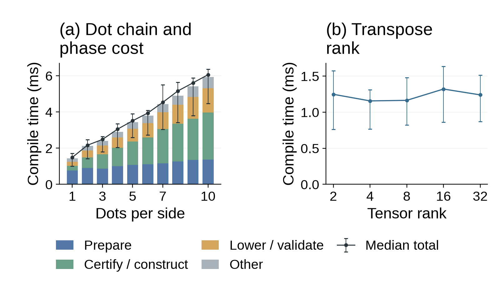

# Certified compilation scalability

All RHS axis fields are inferred. Frozen automatic workloads: 1–10 dots per side at rank three, and three source transposes composed into one replacement at ranks 2, 4, 8, 16, 32. Rule bodies, original guards, and dialect bytes are preserved from the earlier experiment; imports are embedded to make inputs self-contained. Explicit and partial variants are outside this automatic-only experiment; historical 39-configuration default results are retained separately.

Backend: `--certified --semantic-policy algebraic`. 15/15 configurations accept in all 10 measured rounds; one public compile/portable-roundtrip control per case. 60 independent dense-integer workload checks pass.

## Timing boundary

An optimized in-process driver executes the exact API sequence of `core::compile(SourceProject, SemanticOptions{algebraic,false,true})`. Parsing and import loading occur once before timing. Every measured call starts with the loaded syntax project, not a previously prepared proof plan. No previous proof or compiled program is reused.

- Preparation: resolution and type checking, including copying the input project as in the public pipeline.
- Certify / construct: semantic-plan preparation, certified admission, guard certification, and materialization of the portable metadata program.
- Lower / validate: executable lowering, metadata emission and final executable validation.
- Other: return/dispatch and destruction of intermediate compilation objects before the timer stops. Destruction of the resulting executable occurs after timing.

These are measured API boundaries, not inferred subdivisions. Guard checking and metadata construction can occur in more than one phase. Portable loading, CLI process startup, reference execution and graph rewriting are excluded. Public-pipeline serialization equality and portable load/serialization equality are checked outside timing for every input.

Warmups: 1; measured rounds: 10. Serial, seeded shuffled case order (seed 20261026). The normal compiler work budgets remain unchanged; there is no historical ten-second proof deadline. The driver process has an external 300-second limit.

Panel (a) combines arithmetic mean phase times in stacked bars with overlaid median total latency and min/max whiskers. Stacked segments add exactly to mean total compilation latency. Panel (b) shows transpose-rank medians and min/max whiskers. All axes use milliseconds. One machine and ten rounds do not establish broad throughput or numerical-kernel speedups.

CPU: Intel(R) Core(TM) Ultra 7 155H. Platform: Linux-7.0.0-38-generic-x86_64-with-glibc2.43.

## Complete results

| Case | Accepted rounds | Median total (ms) | Prepare | Certify / construct | Lower / validate | Other |
|---|---:|---:|---:|---:|---:|---:|
| chain_automatic_1 | 10/10 | 1.48963 | 0.77100 | 0.27669 | 0.24656 | 0.19307 |
| chain_automatic_2 | 10/10 | 2.16033 | 0.92638 | 0.59429 | 0.39095 | 0.24299 |
| chain_automatic_3 | 10/10 | 2.48089 | 0.88641 | 0.82050 | 0.48417 | 0.26693 |
| chain_automatic_4 | 10/10 | 3.04934 | 1.05517 | 1.08049 | 0.58727 | 0.33824 |
| chain_automatic_5 | 10/10 | 3.51192 | 1.09978 | 1.31159 | 0.69160 | 0.36886 |
| chain_automatic_6 | 10/10 | 3.93963 | 1.12183 | 1.52225 | 0.80615 | 0.41278 |
| chain_automatic_7 | 10/10 | 4.53157 | 1.21634 | 1.86473 | 0.94378 | 0.48457 |
| chain_automatic_8 | 10/10 | 5.16132 | 1.35697 | 2.11200 | 1.09037 | 0.52498 |
| chain_automatic_9 | 10/10 | 5.60759 | 1.39511 | 2.34685 | 1.22137 | 0.59587 |
| chain_automatic_10 | 10/10 | 6.05713 | 1.39183 | 2.65980 | 1.35853 | 0.64061 |
| rank_2_automatic | 10/10 | 1.24766 | 0.74300 | 0.14577 | 0.18139 | 0.17707 |
| rank_4_automatic | 10/10 | 1.15607 | 0.66963 | 0.14666 | 0.17417 | 0.16218 |
| rank_8_automatic | 10/10 | 1.16397 | 0.65940 | 0.15464 | 0.18522 | 0.16586 |
| rank_16_automatic | 10/10 | 1.32051 | 0.75291 | 0.19533 | 0.19621 | 0.17384 |
| rank_32_automatic | 10/10 | 1.23956 | 0.66595 | 0.20874 | 0.19818 | 0.16225 |

Phase medians need not add to the median total; the figure instead stacks phase means.

Raw samples and provenance: [performance.json](performance.json). The source archive and patch preserve the implementation used for this run.
